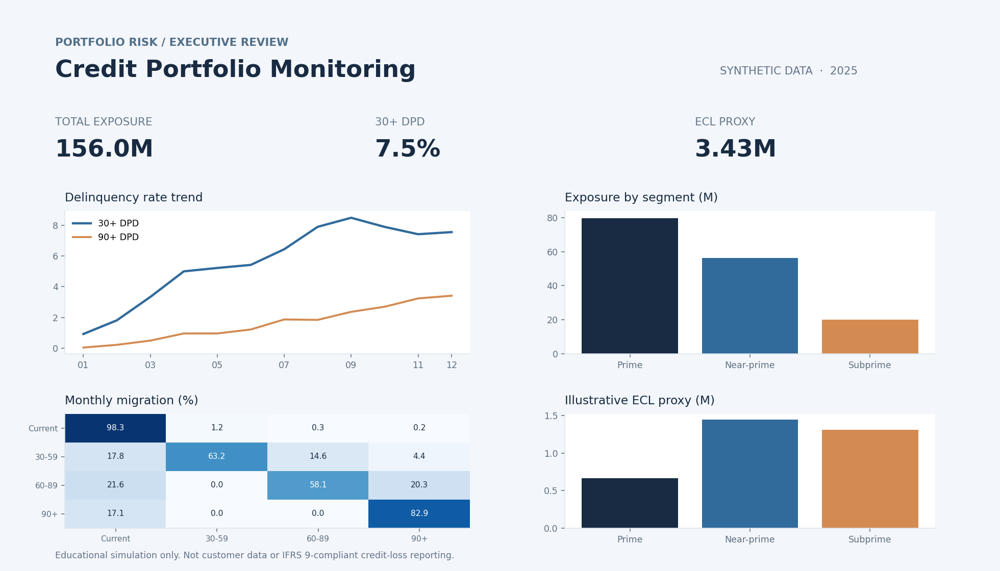

# Credit Risk & Portfolio Analytics

**End-to-end, reproducible portfolio monitoring case study** for Data Analyst, BI Analyst and Credit Portfolio Analyst roles.

> **Synthetic data only.** This is a portfolio demonstration, not real credit underwriting, customer data, an audited risk model, or IFRS 9-compliant reporting.

## Business question
Where is delinquency concentrated, how does it evolve over time, and which loan segments warrant closer monitoring? The deliverable supports a hypothetical portfolio-risk monthly review.

## Deliverables
- 1,600 synthetic loans × 12 month-end snapshots (19,200 rows)
- Python data pipeline with validation and repeatable random seed
- SQLite database and SQL queries for delinquency, monthly roll rates and segmentation
- Self-contained, interactive **HTML dashboard** (`reports/dashboard.html`)
- Derived CSV summary tables and runnable unit tests
- Power BI starter instructions and DAX measures (not a tested PBIX)
- Three learning tasks and an interview preparation checklist

## Preview


## Run locally
Use Python 3.11+:
```bash
python -m venv .venv
# Windows PowerShell: .venv\\Scripts\\Activate.ps1
# macOS/Linux: source .venv/bin/activate
pip install -r requirements.txt
python -m src.pipeline
python -m pytest -q
```
Open `reports/dashboard.html` in your browser. No API keys or internet connection are needed after dependencies are installed.

## KPI definitions
| Metric | Definition |
|---|---|
| EAD | Synthetic month-end outstanding balance, not a validated regulatory EAD. |
| 30+ DPD exposure rate | Sum EAD for accounts with days past due >=30 / total month EAD. |
| 90+ DPD exposure rate | Sum EAD for accounts with days past due >=90 / total month EAD. |
| Monthly roll rate | Count of accounts that transition from one DPD bucket to another in the next month / count starting in that bucket. |
| ECL proxy | Sum(EAD × assumed 12-month PD × assumed LGD). A pedagogical approximation, **not IFRS 9 expected credit loss**. |

## Analytical choices and caveats
- Portfolio is simulated with simplified migration and amortization processes; trends and magnitudes are arbitrary and **cannot be generalized** to real lenders.
- DPD bucket states and probability parameters are simulated, not estimated from historical defaults.
- Account-based roll rates and exposure-based DPD rates measure different things; do not conflate them.
- 90+ DPD is a proxy for severe delinquency, **not a validated definition of default**.
- IFRS 9 requires scenario-weighted, forward-looking, discounted credit losses as applicable, not the simple ECL proxy here.
- Next production step: reconcile source systems, segment by origination vintage, define default/cure governance, add temporal PD modeling and validate fairness/calibration.

## Tools
Python, pandas, NumPy, SQLite / SQL window functions, Plotly, pytest; optional Power BI / DAX.

## Sources (methodology; not inputs for synthetic numbers)
- [EBA Guidelines on Loan Origination and Monitoring](https://www.eba.europa.eu/activities/single-rulebook/regulatory-activities/credit-risk/guidelines-loan-origination-and-monitoring)
- [IFRS Foundation](https://www.ifrs.org/)
- [BIS Basel Committee on Banking Supervision](https://www.bis.org/bcbs/)

## Attribution
Initial scaffold, simulated data, code and dashboards were generated with AI assistance and verified through execution and tests. Personal skills should be claimed only after independently demonstrating them; `LEARNING_TASKS.md` is a separate learning track.
