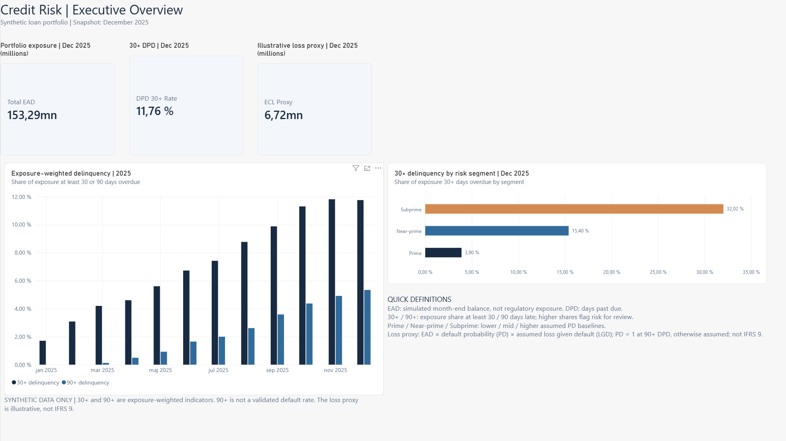
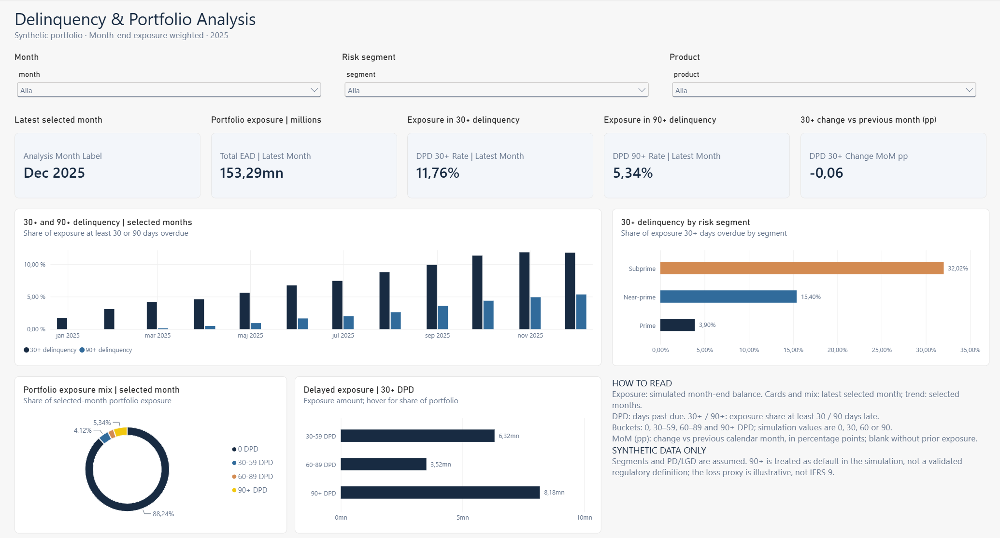

# Credit Risk & Portfolio Analytics

Monthly monitoring of a synthetic consumer-loan portfolio: delinquency, roll rates, an illustrative loss proxy and a PD back-test. Python generates and analyzes the data, SQL reproduces the key queries, and a Power BI project (PBIP) presents the results.

> **All borrower data and outcomes are synthetic.** This is a portfolio case study, not a production underwriting model, a validated default-rate estimate or an IFRS 9 expected-credit-loss calculation.

[Interactive HTML dashboard](https://davka99.github.io/credit-risk-portfolio-analysis/reports/dashboard.html) · [Power BI setup](powerbi/BUILD_GUIDE.md) · [Validation](docs/VALIDATION.md)

## Business question

A portfolio team reviews the loan book every month and needs to answer three questions:

1. How much exposure is delinquent, and is it getting worse?
2. Where is the expected loss concentrated?
3. Are the PD assumptions behind the loss proxy consistent with how the portfolio actually performed?

## Key findings (December 2025)

| Metric | December 2025 | January 2025 |
|---|---:|---:|
| Portfolio exposure (EAD proxy) | 153.29 million | 201.36 million |
| 30+ DPD, exposure-weighted | 11.76% | 1.71% |
| 90+ DPD, exposure-weighted | 5.34% | 0.00% |
| Illustrative loss proxy | 6.72 million | – |

- **Delinquency rose every month until November and dipped slightly in December** (11.81% to 11.76%). 90+ keeps building because defaulted loans stay in the book.
- **Near-prime carries the largest share of the loss proxy.** It holds 36% of exposure but 47% of the loss proxy and 53% of 90+ exposure. Subprime has the highest rates (32.02% at 30+ DPD) but only 13% of exposure, and 34% of the loss proxy.
- **54% of the loss proxy comes from loans already in default**; the remaining 46% is the expected loss on performing loans.
- **Early delinquency is still recoverable.** In a typical month, 19% of 30–59 DPD accounts cure and 26% roll to 60–89. From 60–89 DPD, 31% roll into default within one month.
- **The PD back-test does not show a significant miscalibration.** Observed 12-month default rates versus assumed PD: Prime 2.24% vs 1.84%, Near-prime 6.88% vs 5.74%, Subprime 11.06% vs 14.67%. With 217–802 loans per segment, every assumed PD lies inside the 95% confidence interval of the observed rate.

## Recommendation

1. **Plan collections capacity around Near-prime, not only Subprime.** Near-prime holds most of the delinquent and defaulted exposure, even though its rates are lower.
2. **Intervene before 60 DPD.** At 30–59 DPD, about one in five accounts still cures each month; at 60–89 DPD, about a third default the following month.
3. **Keep the current PD assumptions, but keep testing them.** Prime and Near-prime defaulted more than assumed and Subprime less, but one 12-month window cannot separate this from sampling noise. Repeat the back-test on new windows and vintages before recalibrating.

These recommendations follow from the synthetic data and illustrate the analysis workflow; they are not evidence about real lenders.

## What the simulation sets, and what the analysis finds

Some results follow directly from the simulation design and should not be read as discoveries:

- **Set by design:** segment PD levels (Subprime riskiest), a gradual monthly increase in delinquency onset, and the same roll and cure probabilities in every segment.
- **Found by the analysis:** where exposure and the loss proxy concentrate given the portfolio mix, how much of the loss proxy is already defaulted, and whether realized defaults are consistent with the assumed PDs.

## Dashboards

**Executive Overview** — December portfolio exposure, delinquency and loss proxy.



**Delinquency & Portfolio Analysis** — month, segment and product filters, trends, risk segments and exposure mix.



## Data and model

The dataset contains 1,600 synthetic loans and 19,200 monthly observations for January–December 2025. `Loans` has one row per loan; `MonthlySnapshots` has one row per loan per month, linked one-to-many on `loan_id`. Month-end balances are snapshots, so summing across months is not a single-month exposure.

```text
Loans (1)  ── loan_id ──>  (*) MonthlySnapshots
  segment, product,              month, EAD, DPD,
  assumed PD and LGD             DPD bucket
```

Simulation rules (`src/pipeline.py`, seed `990903`):

- Every loan is current at the start of the window. DPD can rise by at most one 30-day bucket per month.
- 90+ DPD is treated as default and is absorbing: a defaulted loan stays at 90+.
- Current loans amortize 2.2% of the opening balance per paid installment. Missed installments are not amortized, a cured loan has paid its arrears, and defaulted balances are frozen.

## KPI definitions

| Measure | Definition |
|---|---|
| Exposure / EAD proxy | Simulated month-end outstanding balance; not a validated regulatory EAD. |
| 30+ / 90+ DPD rate | Balance on loans with DPD ≥ 30 / ≥ 90 divided by total balance in the same month and filter context. |
| 30+ month-on-month change | Latest selected month's 30+ rate minus the previous calendar month's rate, in percentage points. Blank when the previous month has no exposure. |
| Illustrative loss proxy | Sum of balance × PD × assumed LGD, where PD = 1 for defaulted exposures (90+ DPD) and the assumed 12-month PD otherwise. It excludes IFRS 9 staging, forward-looking scenarios and discounting. |
| Roll rate | Share of accounts moving between delinquency buckets from one month to the next; account-weighted, not exposure-weighted. |
| Observed 12-month default rate | Share of loans in a segment that reach 90+ DPD at any point in the 12-month window, with a 95% Wilson confidence interval. |

## Project structure

| Path | Content |
|---|---|
| `src/pipeline.py` | Data generation, validation, KPIs, roll rates, PD back-test and HTML dashboard |
| `sql/portfolio_analysis.sql` | SQLite queries: monthly delinquency, roll rates, segment loss proxy, PD back-test |
| `powerbi/` | Power BI project (PBIP with PBIR report and TMDL semantic model), DAX measures and theme |
| `tests/` | pytest suite |
| `data/`, `reports/`, `reference/` | Generated synthetic data, KPI outputs and reference values used by the tests |

## How to run

Requires Python 3.12. From the project root in Windows PowerShell:

```powershell
py -3.12 -m venv .venv
.\.venv\Scripts\python.exe -m pip install -r requirements.txt
.\.venv\Scripts\python.exe -m pytest -q -p no:cacheprovider
```

To regenerate the data, SQLite database, KPI reports and HTML dashboard (overwrites the files in `data/` and `reports/`):

```powershell
.\.venv\Scripts\python.exe -m src.pipeline
```

To open the Power BI report, open `powerbi/CreditRisk.pbip` in Power BI Desktop, set the `DataFolderPath` parameter to the absolute path of the `data` folder and refresh. See [Power BI setup](powerbi/BUILD_GUIDE.md).

## Quality assurance

- **51 Python tests pass** (2026-11-10), covering delinquency transition rules, balance rules, the loss proxy and the PD back-test in both Python and SQL, data contracts, reference KPI values and report structure. GitHub Actions runs the suite on every pull request and push to `main`.
- **Power BI Desktop check** (2026-11-10): after refresh on the current data, December exposure, 30+ and 90+ rates, month-on-month change, segment rates, delinquent-bucket amounts and the loss proxy matched the Python results.
- The full measure-by-measure reconciliation against exported DAX results is described in [Validation](docs/VALIDATION.md); it has not been repeated on the current data.

## Limitations

- All data is synthetic, and segment risk levels are set by assumption.
- The observation window is 12 months for loans originated within six months of each other, so vintage analysis is not meaningful on this data.
- Roll and cure probabilities are the same in every segment, so segment differences in roll rates cannot be analyzed.
- The loss proxy is not IFRS 9 ECL and 90+ DPD is a simulation default, not a validated regulatory definition.

## Technology

Python 3.12, NumPy, pandas, Plotly, pytest, SQLite, Power Query (M), DAX, Power BI PBIP (PBIR and TMDL), GitHub Actions.
