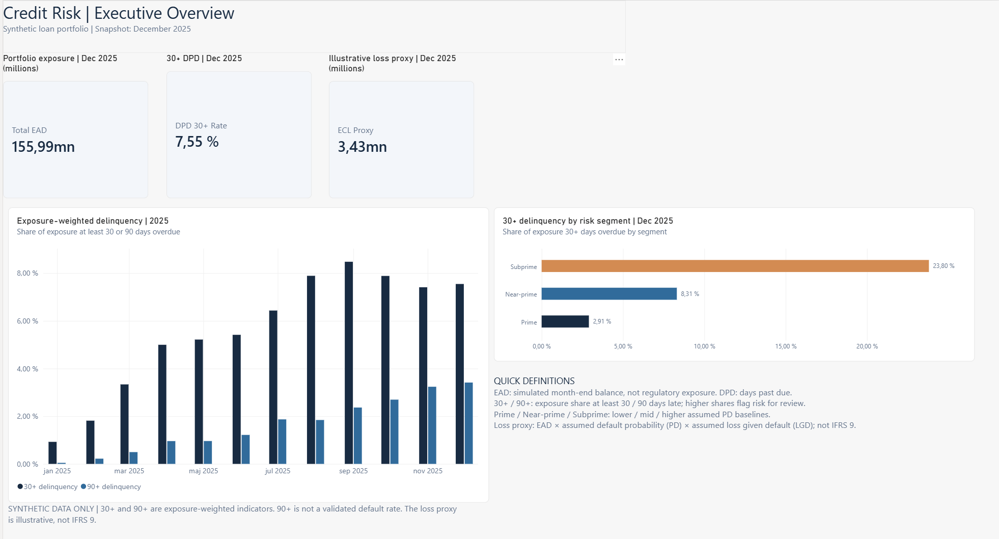
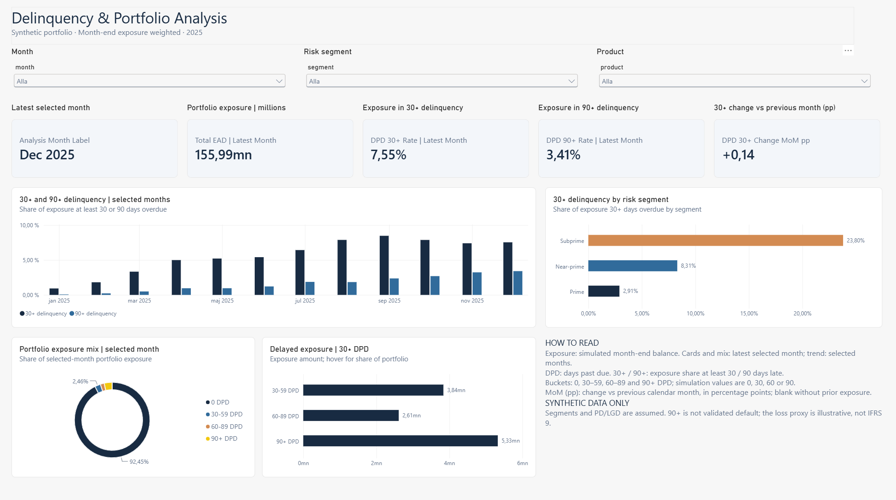

# Credit Risk & Portfolio Analytics

A reproducible synthetic credit-portfolio monitoring project for exploring exposure-weighted delinquency, risk segments, and monthly portfolio movement. Python generates and analyzes the data; SQLite illustrates SQL analysis; a Power BI Desktop project provides an editable report and semantic model as versionable text.

**All borrower data and outcomes are synthetic.** This is a portfolio case study, not a production underwriting model, a validated default-rate estimate, or an IFRS 9 expected-credit-loss calculation.

[Interactive HTML dashboard](https://davka99.github.io/credit-risk-portfolio-analysis/reports/dashboard.html) · [Power BI setup](powerbi/BUILD_GUIDE.md) · [Validation](docs/VALIDATION.md) · [Publication audit](PUBLICATION_READINESS.md)


## Business question

A portfolio team needs to understand how exposure and overdue accounts evolve, which simulated risk segments warrant investigation, and where severe delinquency is concentrated. The report supports monitoring and discussion; it does not establish causality or recommend an underwriting decision.

## Data and model

The dataset contains 1,600 synthetic loans and 19,200 monthly observations for January–December 2025. `Loans` has one row per loan; `MonthlySnapshots` has one row per loan per month. A single-direction one-to-many relationship on `loan_id` links the dimension to snapshots. Month-end balances are snapshots, so summing across months is not a single-month exposure.

```text
Loans (1)  ── loan_id ──>  (*) MonthlySnapshots
  segment, product,              month, EAD, DPD,
  assumed PD and LGD             DPD bucket
```

The existing CSVs are synthetic, reproducible inputs. The pipeline also writes a SQLite copy, KPI CSVs and the Plotly HTML dashboard. The input CSVs and SQLite file are present for SQL practice; Power BI imports the CSVs. The simulation generates DPD values 0, 30, 60 and 90. `Current` is 0 DPD in this dataset; intervals are presentation buckets, not evidence of observed repayment behavior.

## Measures and limitations

| Measure | Definition |
|---|---|
| Exposure / EAD proxy | Simulated month-end outstanding balance; not a validated regulatory EAD. |
| 30+ / 90+ DPD rate | Balance on loans with DPD ≥ 30 / ≥ 90 divided by total balance for the same context. |
| 30+ month-on-month change | Latest selected month's 30+ rate minus the immediately preceding calendar month's rate, expressed in percentage points. Blank when the prior month has no positive exposure. |
| Illustrative ECL proxy | Sum of balance × assumed 12-month PD × assumed LGD. It excludes full IFRS 9 staging, forward-looking scenarios and discounting. |
| Roll rate | Account-count share transitioning between consecutive recorded delinquency buckets; it is not exposure-weighted. |

90+ DPD is a severe-delinquency indicator, not a validated contractual or regulatory default definition. Prime, Near-prime and Subprime are simulated segments with different assumed PD baselines; findings do not generalize to real lenders.

## Reports

- **Executive Overview:** December snapshot cards, monthly delinquency history and comparison by risk segment.
- **Delinquency & Portfolio Analysis:** month, segment and product filters; latest-selected-month snapshot cards; change against the prior calendar month; selected-month trend; exposure mix and delinquent-bucket comparison. Cards and distributions use the latest month within the selection, rather than summing balances across months.

The Power BI project is stored as PBIP with PBIR report definitions and TMDL semantic-model definitions. The custom JSON theme is under `powerbi/themes/`; a registered copy is included with the report. The opening preview shows the HTML dashboard.

**Executive Overview** — December portfolio exposure and delinquency.



**Delinquency & Portfolio Analysis** — trends, risk segments and exposure mix.



## Python setup and reproduction

Requires Python 3.11+ and Internet access to install packages. From the project root in Windows PowerShell:

```powershell
py -3 -m venv .venv
.\.venv\Scripts\python.exe -m pip install -r requirements.txt
.\.venv\Scripts\python.exe -m pip check
.\.venv\Scripts\python.exe -B -m pytest -q -p no:cacheprovider
```

To regenerate the synthetic data, SQLite, KPI reports and HTML dashboard:

```powershell
.\.venv\Scripts\python.exe -B -m src.pipeline
```

**The pipeline overwrites** the generated files in `data/` and `reports/`. Use a disposable copy if you want to preserve the checked-in versions. NumPy random seed is `990903`; exact packages are specified as ranges rather than a lockfile.

## Open Power BI Desktop

1. Open `powerbi/CreditRisk.pbip` in a compatible Power BI Desktop version. Keep `CreditRisk.Report` and `CreditRisk.SemanticModel` adjacent to it.
2. In **Transform data → Manage parameters**, set `DataFolderPath` to the absolute path of this clone's `data` folder. The checked-in placeholder `SET_DATA_FOLDER_PATH` is intentionally not a working path. There is no portable automatic detection of the PBIP folder.
3. Apply the change, grant local file access if prompted, and refresh. Both CSVs must be in that folder with their original names.
4. Verify that both pages load, filters work, the portfolio exposure card and bucket totals agree, and the latest-month/previous-month behavior matches the definitions above. Project cache and per-user settings are intentionally excluded; a fresh project opens without cached data until refresh.

See [Power BI setup and limitations](powerbi/BUILD_GUIDE.md). A successful Desktop open and refresh on a fresh clone remains an external verification item.

## Quality assurance

`pytest` tests the generator, data contracts, reference calculations and report structure. The included Python comparator accepts exported DAX results from the actual model; it does not evaluate DAX by itself. Previous actual-model exports were reconciled for 12 months and 36 month–segment combinations across four original measures, with one documented BLANK handled conditionally. They are not included as source files; obtain fresh exports from the model for a new run. The newer presentation measures and the final styling still require fresh Desktop validation.

See [validation instructions](docs/VALIDATION.md). Never present a static model check or simulated export test as an actual Power BI DAX run.

## Technology

Python 3.11+, NumPy, pandas, Plotly, pytest, SQLite SQL, Power Query/M, DAX, PBIR and TMDL. Power BI Desktop is a separate installation. The initial pipeline, code and documentation used AI assistance; verification status is documented rather than inferred.
